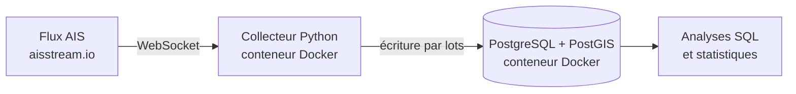

# Pipeline de données AIS – Trafic maritime en Manche

Pipeline de collecte en temps réel des données AIS (Automatic Identification System) des navires circulant dans la Manche, l'une des zones maritimes les plus fréquentées au monde.

Le projet ingère un flux WebSocket continu, structure les données dans PostgreSQL/PostGIS selon un modèle faits/dimension, et tourne de façon autonome dans des conteneurs Docker.

## Architecture



## Fonctionnalités

- Ingestion temps réel des positions (`PositionReport`) et des données statiques des navires (`ShipStaticData`) sur une zone géographique définie
- Écriture en base par lots (100 messages ou 10 secondes) pour limiter le coût des transactions
- Reconnexion automatique avec backoff exponentiel en cas de coupure du flux
- Modèle de données faits/dimension : `positions` (table de faits) et `navires` (table de dimension mise à jour par upsert)
- Colonne géographique PostGIS générée automatiquement, avec index spatial
- Horodatages stockés en UTC
- Infrastructure conteneurisée : un seul `docker compose up` démarre la base et le collecteur, avec healthcheck et redémarrage automatique

## Stack technique

Python 3.12 (asyncio, websockets, psycopg 3), PostgreSQL 16, PostGIS 3.4, Docker, Docker Compose.

## Modèle de données

**positions** : une ligne par position reçue (MMSI, coordonnées, vitesse, route, cap, statut de navigation, heure d'émission AIS, heure de réception, point géographique).

**navires** : une ligne par navire (MMSI, nom, numéro IMO, indicatif, type, dimensions, tirant d'eau, destination déclarée).

## Lancer le projet

Prérequis : Docker Desktop et une clé API gratuite [aisstream.io](https://aisstream.io).

1. Créer un fichier `.env` à la racine :
   ```
   POSTGRES_USER=ais
   POSTGRES_PASSWORD=un_mot_de_passe
   POSTGRES_DB=ais
   POSTGRES_PORT=5433
   AISSTREAM_API_KEY=votre_clé
   ```
2. Démarrer l'infrastructure :
   ```
   docker compose up -d --build
   ```
3. Suivre la collecte :
   ```
   docker compose logs -f collecteur
   ```
4. Consulter les statistiques depuis la machine hôte :
   ```
   pip install -r requirements.txt
   python ais_stats.py
   ```

## Feuille de route

- [x] Ingestion temps réel et stockage
- [x] Modèle faits/dimension
- [x] Conteneurisation
- [ ] Contrôles de qualité des données (positions aberrantes, doublons, trous de couverture)
- [ ] Orchestration des traitements
- [ ] Analyses : temps d'attente portuaires, flux par type de navire, visualisation cartographique
